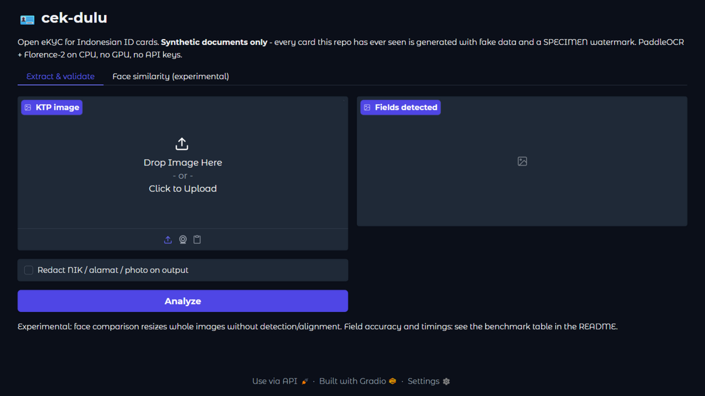
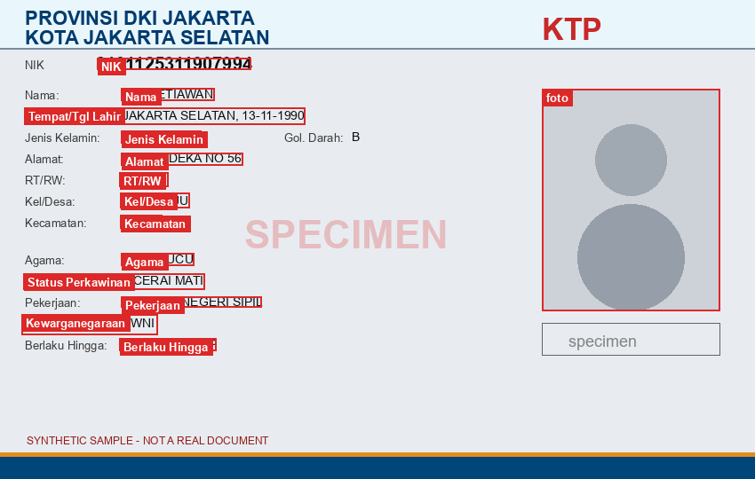
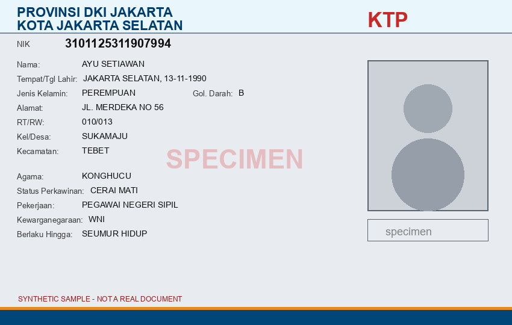
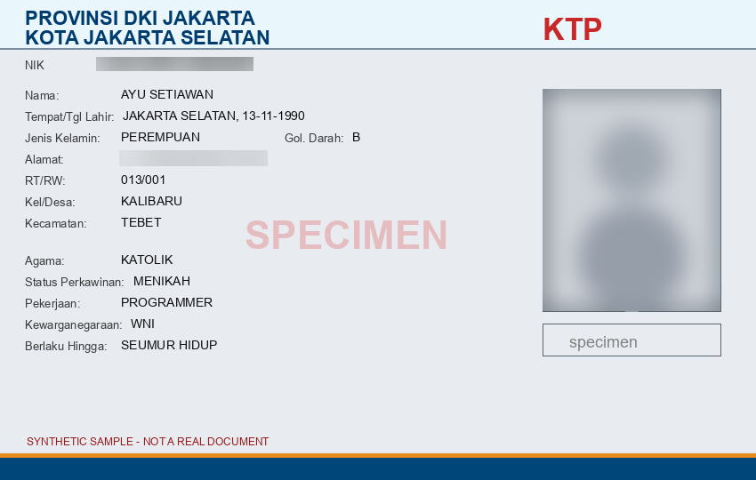
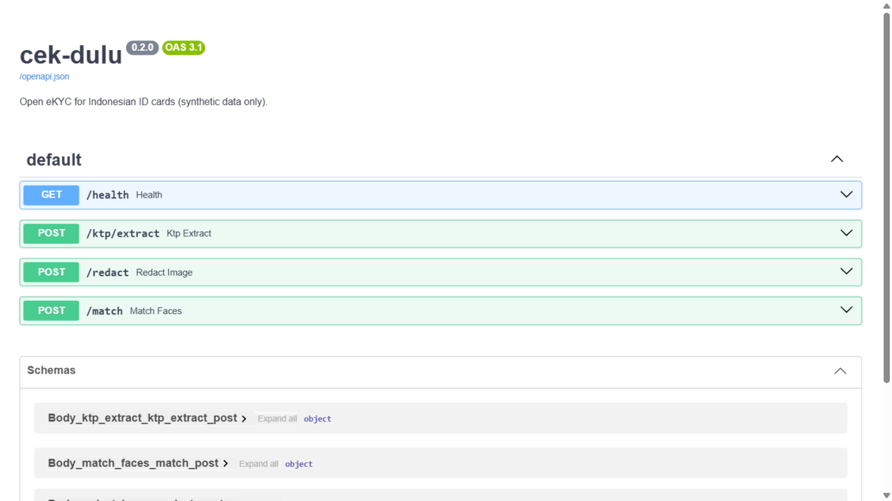

# 🪪 cek-dulu

**Open eKYC for Indonesian ID cards: document QA, field extraction, NIK validation, face similarity, and redaction. CPU-only, pretrained-only, synthetic data only.**


*Left to right: the synthetic card, fields localized by the pipeline, then the redaction toggle (NIK, alamat, photo).*

| System | Screenshot |
|---|---|
| Gradio demo |  |
| Field detection |  |
| Redaction off / on |  →  |
| OpenAPI docs |  |

## What is this project?

A complete, honest eKYC pipeline for KTP (Kartu Tanda Penduduk) photos, built to answer one question: what does it take to go from a photographed ID card to a validated, structured record, with every claim measured?

The pipeline:

1. **Document QA**: rejects blurry, glare-washed, skewed, or undersized inputs, with explicit reasons (never silent).
2. **Field localization**: PaddleOCR text-line detection plus fixed-layout priors assigns every field row; Florence-2 phrase grounding pins the photo box.
3. **Parsing and NIK validation**: 38-province administrative codes, the +40 female day encoding, cross-field checks of the decoded birth date and gender against the printed TTL and Jenis Kelamin. Impossible calendar dates are rejected, never clamped.
4. **Face similarity** (experimental): ArcFace-family embeddings with the threshold stated next to every verdict.
5. **Redaction**: blur NIK, alamat, and photo on output, because privacy defaults should not be opt-in.

Everything runs offline on a laptop CPU. No GPU, no API keys, no cloud calls.

### Why synthetic data only

Every card in this repo is generated by `app/synthetic_ktp.py`: fake names, structurally valid NIKs, a SPECIMEN watermark, and a "SYNTHETIC SAMPLE" footer. Rendering the cards also produces exact ground-truth bounding boxes, which is how the benchmark below can compare localized fields against truth without any manual labeling. No real personal data has ever been part of this repo.

## Example

`POST /ktp/extract?mode=model` with a card photo returns:

```json
{
  "qa": { "ok": true, "checks": [ { "name": "sharpness", "value": 55.8, "threshold": 25.0, "passed": true } ] },
  "extracted": {
    "nik":     { "text": "3102125311900465", "conf": 0.99 },
    "nama":    { "text": "AYU SETIAWAN", "conf": 0.98 },
    "ttl":     { "text": "JAKARTA SELATAN, 13-11-1990", "conf": 0.97 },
    "alamat":  { "text": "JL. DIPONEGORO NO 98", "conf": 0.96 }
  },
  "validation": {
    "ok": true,
    "province": "DKI JAKARTA",
    "birth_date": "1990-11-13",
    "gender": "PEREMPUAN",
    "issues": []
  }
}
```

## Architecture

```
            upload
              │
              ▼
        ┌───────────┐   blur / glare / skew / size
        │ app/qa.py │───────────────► rejected + reasons
        └─────┬─────┘
              │ pass
              ▼
   ┌─────────────────────┐   text lines + boxes
   │ PaddleOCR (2.7.3)   │──────────────┐
   └─────────────────────┘              │
   ┌─────────────────────┐   photo box  │
   │ Florence-2-base     │──────────────┤
   │ (phrase grounding)  │              ▼
   └─────────────────────┘    assign_fields(): content rules
              │               + fixed-layout priors
              ▼                       │
   validators/nik.py  ◄───────────────┘
   structure, +40 day, province table,
   cross-field TTL/gender checks
              │
              ▼
   app/api.py  (FastAPI)   app/redact.py   app/face.py (experimental)
```

## Benchmark (real models, no stubs)

20 synthetic cards, CPU only (Ryzen laptop, no GPU). Raw output: `docs/benchmark.json`, produced by `scripts/benchmark.py`.

| Field | Exact match | Mean normalized distance |
|---|---|---|
| nik | **20 / 20** | 0.000 |
| jenis_kelamin, alamat, rt_rw, kel_desa, kecamatan, agama, status_perkawinan, pekerjaan | **20 / 20 each** | 0.000 |
| nama | 19 / 20 | 0.004 |
| ttl | 19 / 20 | 0.002 |
| kewarganegaraan | 16 / 20 | 0.050 |
| gol_darah | 0 / 20 | 1.000 |

- NIK validation passed on all 20 valid cards (structural + cross-field). Tampered
  cards are rejected in the unit-test suite; there is no negative-case model
  benchmark yet, so "20/20" describes valid cards only, not verdict accuracy.
- QA gates: blur, glare, and skew perturbations all correctly rejected
- Latency: **mean 10.1 s per card** (min 8.2, max 32.0; includes OCR + photo grounding)
- Photo-box provenance, recorded per card: **Florence-2 grounding 4 / 20,
  layout prior 16 / 20**. On these synthetic silhouette photos the phrase
  grounding usually returns nothing and the fixed-layout fallback carries the
  box; `docs/benchmark.json` lists the source for every card.
- Face similarity: same-card perturbed crops score 0.978; cross-card placeholder silhouettes score 1.000 because the generator draws identical silhouettes. This is a property of synthetic data, and the reason the face tab is labeled experimental rather than a verification claim.

These numbers describe performance on clean synthetic renders. Real captures now go through the preprocessing stack above and were validated on 3 owner-provided photos (see Real-photo handling); scaled measurement on a real-photo set is future work.

## Real-photo handling

The pipeline preprocesses every uploaded capture before QA:

1. **Card localization**: contour-quad detection (with a CLAHE-boosted retry for dim shots) perspective-warps the card onto the canonical 850x540 canvas; edge-to-edge renders fall back to aspect resize.
2. **Exposure fix**: CLAHE on the L channel when the capture is dim or flat.
3. **Deskew retry + NIK refine**: after OCR, if the text rows still tilt, the image is rotated by the measured slope and re-OCR'd once; the NIK row is cropped, upscaled 3x, and re-read separately (small fonts over guilloche misread at full-image scale).
4. **Shear-leveled pairing**: field assignment runs in coordinates leveled by the median OCR line angle, so tilted cards pair labels to values correctly.

Field assignment is content-driven (printed-label anchors with OCR-mangling tolerance, header/label exclusion, one-to-one label-value pairing), with the synthetic-geometry priors as a last-resort fallback.

**Validation on owner-provided real photos (3 samples, not a benchmark):** all three NIKs extracted exactly, including a dim tilted handheld shot; names/TTL/gender extracted with occasional single-glyph OCR noise; a non-genuine sample was flagged by the NIK-vs-TTL cross-field check and a non-lifetime-validity authenticity note. Real-photo support is validated on samples, not measured at scale: the field-accuracy table above remains synthetic-only.

## Quickstart

```bash
python -m venv .venv
.venv\Scripts\activate            # Windows; source .venv/bin/activate on POSIX
pip install -r requirements.txt
pip install torch --index-url https://download.pytorch.org/whl/cpu   # CPU wheel
pip install -r requirements-dev.txt

python scripts/generate_golden.py          # synthetic golden set (PNGs are generated; only ground truth is tracked)
pytest                                     # 59 tests, no weights needed
uvicorn app.api:app --port 8765            # API + Swagger at /docs
python demo/app.py                         # Gradio demo at :7860
python scripts/benchmark.py                # reproduce the table above
```

First run downloads model weights (Florence-2-base ~0.4 GB, PaddleOCR ~20 MB, ArcFace ONNX ~170 MB) into `.models/` and `~/.paddleocr`, then everything runs offline.

## API

| Endpoint | Method | What it does |
|---|---|---|
| `/health` | GET | Service heartbeat |
| `/ktp/extract` | POST | QA + extraction + NIK validation. `mode=gold` (no upload, uses committed synthetic set) or `mode=model` (multipart image) |
| `/redact` | POST | Blurred copy (NIK, alamat, photo by default). Reports skipped fields in `X-Skipped-Fields` |
| `/match` | POST | Experimental crop similarity between two images, threshold stated in the response |

```bash
# weight-free smoke test
curl -X POST "http://127.0.0.1:8765/ktp/extract?mode=gold&index=0"

# real path
curl -X POST "http://127.0.0.1:8765/ktp/extract?mode=model" -F "image=@card.png"

# redacted output
curl -X POST "http://127.0.0.1:8765/redact?mode=model&fields=nik,foto" -F "image=@card.png" -o redacted.png
```

Uploads are size-capped (10 MB), decode-verified, and stored under server-controlled per-request paths; client filenames are never used as paths.

## Model licenses

| Component | License | Note |
|---|---|---|
| PaddleOCR / paddlepaddle | Apache 2.0 | OCR text lines |
| Florence-2-base | MIT | photo-box phrase grounding |
| InsightFace buffalo_l (w600k_r50) | non-commercial research | face embeddings; the embedding interface in `app/face.py` is one function, swap-in ready for a permissively licensed model |
| This repo's code | MIT | see LICENSE |

## Honest limitations

- `gol_darah` scores 0 / 20: a one-character field that PaddleOCR does not reliably emit as its own line. Reported as-is rather than hidden.
- `kewarganegaraan` at 70%: "WNI" is three characters and sometimes merges with its label.
- Field assignment uses fixed-layout priors (row order, columns). Cards photographed at extreme angles, cropped, or of the older non-standard layouts can misassign rows. Florence-2 photo grounding succeeded on only 4 / 20 benchmark cards; the layout prior produced the other 16 boxes, and the benchmark records which (see provenance above).
- NIK day encoding 20/60 decodes literally to day 20. When the printed TTL disagrees, validation fails with a caveat naming the placeholder convention instead of silently passing; the distinction between a real day-20 birthday and an administrative placeholder cannot be made from the NIK alone.
- No liveness or anti-spoofing. The face endpoint compares whole resized images without detection or alignment: it is a crop-similarity experiment, not identity verification, and the API response says so.
- Benchmarks run on synthetic renders; real-photo distribution shifts are expected.

## Testing and CI

- 59 tests: validators (structure, cross-field, impossible dates, placeholder caveat), generator invariants, QA gates, parsing, API hardening (path traversal, request isolation, upload limits, structured missing-NIK), redaction cleanup paths, barrier-synchronized request isolation, and Gradio wiring arity.
- Model-dependent tests are marker-gated (`pytest -m models`) and excluded from CI; CI runs ruff + unit tests + docker build.
- The security regression suite came out of an independent audit; every finding has a named test.

## Project structure

```
cek-dulu/
├── app/
│   ├── api.py            # FastAPI service (per-request temp dirs, hardened uploads)
│   ├── detect.py         # OCR lines + layout priors; Florence-2 photo grounding
│   ├── face.py           # ArcFace-family ONNX similarity (experimental)
│   ├── ocr.py            # engine plumbing + gold-mode stub
│   ├── parse_fields.py   # normalization, date/NIK parsing, edit distance
│   ├── preprocess.py     # card quad warp, CLAHE, deskew retry (real captures)
│   ├── pipeline.py       # QA -> localize -> parse -> validate
│   ├── qa.py             # blur/glare/skew/size gates with reasons
│   └── synthetic_ktp.py  # SPECIMEN-watermarked card generator + ground truth
├── validators/nik.py     # 38-province table, +40 day encoding, cross-field checks
├── demo/app.py           # Gradio demo (HF Spaces entrypoint)
├── scripts/              # generate_golden, benchmark, make_readme_assets
├── data/golden/          # 20 clean + 3 perturbed synthetic cards + ground truth
├── docs/                 # benchmark.json + README images
└── tests/                # 59 tests incl. security regressions
```

## Credits

- [Florence-2](https://arxiv.org/abs/2311.06242) (Microsoft, MIT) for phrase grounding.
- [PaddleOCR](https://github.com/PaddlePaddle/PaddleOCR) (Apache 2.0) for text-line detection and recognition.
- [InsightFace](https://github.com/deepinsight/insightface) ArcFace embeddings (non-commercial research weights).
- NIK structure references: Peraturan BSN 2 of 2016 and Dukcapil encoding practice (+40 female day, 20/60 placeholders).
